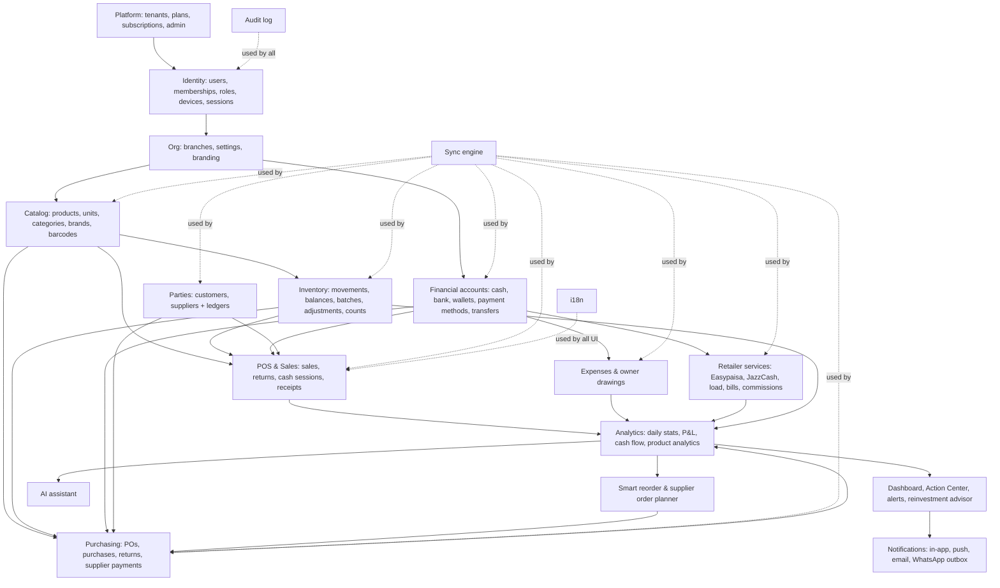

# 01 — Architecture

## 1. Recommended technology stack

| Layer | Choice | Why |
|---|---|---|
| Monorepo | **pnpm workspaces + Turborepo** | Web, admin and API share types, Zod schemas and the posting engine |
| Language | **TypeScript** (strict), everywhere | One domain model from the browser to the DB |
| Web app (tenant) | **React 19 + Vite + TanStack Router + TanStack Query** | Fast, type-safe routing; Vite builds for the PWA |
| Admin app | Same stack, a separate app and deploy (`admin.` domain) | Admin code never ships to tenant devices |
| UI | **Tailwind CSS + shadcn/ui (Radix)** + lucide icons | Accessible primitives, no heavy runtime, easy RTL |
| Forms/validation | **react-hook-form + Zod** (schemas shared with the API) | One validation source |
| Local DB | **Dexie 4 (IndexedDB)** + `dexie-react-hooks` (`useLiveQuery`) | Reactive queries; the UI reads local data only |
| PWA | **vite-plugin-pwa (Workbox)**: app-shell precache, runtime cache | Installable on Windows, Android and tablets |
| i18n | **i18next + react-i18next**, ICU plurals, `dir="rtl"` switch | Urdu-ready, no hardcoded strings |
| Charts | **Recharts** (lazy-loaded) | Enough for dashboards |
| API | **Node 22/24 LTS + Fastify 5** + `fastify-type-provider-zod` | Fast, schema-first, OpenAPI generated from Zod |
| ORM / queries | **Drizzle ORM** (`mysql2` driver) + drizzle-kit migrations | SQL-close and typed. A thin tenant-scoped wrapper adds `tenant_id` to every query (see §3). |
| Database | **MySQL 8.4 LTS** (InnoDB, utf8mb4) | Your choice (Q1). `DECIMAL`, `JSON`, CHECK constraints, window functions, `FOR UPDATE SKIP LOCKED`. Dev: native Windows install (no-install ZIP). Prod: MySQL 8.4 on the VPS or a managed MySQL. |
| Background jobs | **MySQL-backed job table** (`jobs`, polled with `SELECT … FOR UPDATE SKIP LOCKED`) behind a small `JobQueue` interface | No Redis to install or run. One shop, and later a few hundred, is well within its capacity. The interface lets us switch to Redis + BullMQ when scale needs it. |
| File storage | `Storage` interface: **local disk in dev and at launch**, S3-compatible (Cloudflare R2 / Backblaze B2) later | Logos, product images, expense receipts, backup copies |
| Auth | Own implementation: **argon2id**, EdDSA JWT access token (15 min), rotating refresh token (httpOnly cookie) | No per-user vendor cost, works with offline device model |
| AI | **Claude API** (tool-calling over tenant-scoped query functions) | Answers only from tenant data (Phase 8) |
| Testing | **Vitest** (unit), **integration tests against a local MySQL test database** (recreated per run), **Playwright** (E2E + offline simulation), `fake-indexeddb` (sync tests) | |
| Observability | **pino** logs → Loki or file; **Sentry** (errors, web + API); `/healthz`, `/readyz` | |
| Deploy | **Later (Phase 10):** a VPS with Caddy (auto-HTTPS) + Node API/worker (PM2 or Docker) + MySQL. **Now:** everything runs natively on this Windows PC, no Docker (Q2). | Docker is optional, not required at any stage |
| CI | GitHub Actions: typecheck, lint, test, build images | |

**Explicitly not chosen:** Next.js (SSR adds nothing for an offline PWA), Firebase/Supabase-as-backend (tenant isolation and posting logic must be server-owned), PouchDB/CouchDB (does not fit relational accounting), GraphQL (REST + sync endpoints is simpler here).

---

## 2. System architecture

```text
 ┌──────────────── Shop device (browser / installed PWA) ─────────────────┐
 │  React UI  ──reads──▶  Dexie (IndexedDB)  ◀──writes── Domain services  │
 │     │                    ▲   │                         (posting engine │
 │     │ useLiveQuery       │   │ outbox (sync_queue)      shared pkg)     │
 │     ▼                    │   ▼                                          │
 │  Service Worker      Sync Engine (leader tab via Web Locks)             │
 │  (app shell cache)    push mutations ▲ pull changes (cursor)            │
 └──────────────────────────────────────┼──────────────────────────────────┘
                                        │ HTTPS (JWT, device-id)
 ┌──────────────────────────────────────▼──────────────────────────────────┐
 │  Caddy (TLS, HTTP/2, static files for app./admin.)                     │
 │  API (Fastify)                                                          │
 │   ├─ auth + tenant-context middleware (tenant from token only)          │
 │   ├─ REST modules (catalog, sales, purchases, …)  ── thin, online use   │
 │   ├─ /sync/push  → validate → posting engine → ledgers (1 DB txn)       │
 │   ├─ /sync/pull  → change log since cursor                              │
 │   └─ /admin/*    (separate audience, separate DB role, audited)         │
 │  Worker (MySQL job table): alerts, reorder calc, daily stats, notif.,   │
 │                  imports/exports, WhatsApp/email outbox, backups        │
 └──────────────┬───────────────────────────┬──────────────────────────────┘
                │                           │
        MySQL 8.4 (InnoDB)                          file storage (disk → S3)
```

**Principles**

1. **The UI never waits on the network for core flows.** POS, expenses, payments and Easypaisa all write to Dexie first. The network is a background concern.
2. **The server is the source of truth for balances.** Devices hold *provisional* projections, which are replaced after pull.
3. **Documents in, ledgers out.** Clients send business documents (sale, purchase, expense…). Ledger rows (stock movements, account transactions, party ledgers) are *derived* by the posting engine and are never hand-edited.
4. **Reports come from ledgers.** Profit = revenue − COGS (from stock movements at cost) − expenses. It is never sales − purchases.
5. **Modular monolith.** One API deployable with strict module boundaries (`modules/<name>`). It can be split later if needed. It doesn't need to be.

### Posting engine: event → ledger entries

| Event | Postings |
|---|---|
| Sale (cash) | `inventory_movements` −qty @ cost (COGS) · `account_transactions` +total on the cash drawer · revenue lives on `sales`/`sale_items` |
| Sale (credit/partial) | the above, plus `customer_ledger` debit for the unpaid part |
| Sale return | +qty movement (if restocked) · refund account txn *or* customer-ledger credit |
| Purchase received | +qty movement @ landed unit cost (updates WAC) · `supplier_ledger` credit · cash/bank txn for the paid part |
| Supplier payment | account txn − · `supplier_ledger` debit |
| Customer payment | account txn + · `customer_ledger` credit |
| Expense | account txn − · counted in the P&L |
| Owner drawing | account txn − · **not** in the P&L; shown in cash flow |
| Transfer (cash → bank, cash → Easypaisa float) | two account txns (out/in), net zero |
| Easypaisa cash-in (customer deposits Rs X) | float −X · cash drawer +X (+fee if charged in cash) · **+commission into the float at once** (per-transaction settlement, Q3) |
| Easypaisa cash-out | float +X · cash drawer −X · +commission into the float |
| Sale paid by Easypaisa (merchant receipt) | ordinary sale; payment leg = +total on the Easypaisa wallet as `sale_receipt` (shop money, not retailer money) |
| Stock adjustment / damage / expiry | ±qty movement @ cost; loss is reported as "inventory shrinkage" in the P&L |

Every posting row carries `source_type` + `source_id` (+ `source_line_id`), so any number on any report can be drilled down to its documents.

### Costing method

**Moving weighted average cost (WAC) per product per branch.** It suits karyana shops, where the same item is bought many times at small price changes. Batches carry their own cost for expiry and FEFO picking, but COGS uses WAC. This keeps offline costing simple and predictable. FIFO costing is out of scope.

---

## 3. Multi-tenant architecture

**Model: shared database, shared schema, `tenant_id` column** on every tenant-owned table. Schema-per-tenant or database-per-tenant doesn't pay off at thousands of small shops: migrations fan out and the connection count explodes.

### Isolation layers (defence in depth)

| Layer | Mechanism |
|---|---|
| 1. Identity | `tenant_id` comes **only** from the verified access token (`tid` claim). Any `tenant_id` in a request body is ignored or overwritten. `X-Tenant` headers aren't accepted. |
| 2. Membership | On every request the token's `(user, tenant)` membership is checked as active (cached 60 s in memory). Suspended tenant or revoked device → 403. |
| 3. Application | A repository helper `db.forTenant(ctx)` is the only way to get a query handle. Lint rule: no raw `db` import inside `modules/*`. |
| 4. Query layer (replaces Postgres RLS) | MySQL has no row-level security, so this layer carries the weight. `tenantDb(ctx)` wraps Drizzle: every `select/update/delete` on a 🔒 table gets `AND tenant_id = ?` added, and every `insert` gets `tenant_id` set from the context, overwriting any value in the payload. Calling it without a context throws, so it fails closed. A lint rule bans importing the raw connection inside `modules/*`, and raw SQL is allowed only in reviewed `reports/*.sql.ts` files that must take `tenantId` as their first parameter. |
| 5. Referential | Composite FKs, e.g. `sale_items(tenant_id, sale_id) → sales(tenant_id, id)`, so a row can't point into another tenant even with a bug. |
| 6. Client | IndexedDB database name = `retailos_<tenantId>_<userId>`. Logout offers "wipe local data". A device is bound to one tenant. |
| 7. AI | AI tools are server functions that get the tenant from the session. The model never receives SQL access or other tenants' data. |
| 8. Tests | An automated isolation suite creates tenants A and B and asserts every endpoint and sync pull from A returns 0 rows from B (runs in CI). |

### Platform admin access to tenant data

- Admin users are a **separate identity table** (`platform_admins`) with a separate JWT audience and mandatory TOTP 2FA.
- The admin API uses a separate MySQL user. It sees tenant *metadata* (name, plan, counts, usage) through dedicated views, **not** business rows.
- Viewing tenant business data needs a **break-glass grant**: the admin enters a reason, it's time-boxed (e.g. 60 min), read-only by default, and written to `platform_audit_logs` and the tenant's own `audit_logs`, where the tenant owner can see it.

### Branches

`tenant → branches`. Every operational document has `branch_id`. Users get branch access via `membership_branches`. Starter plan = 1 branch, created automatically and hidden in the UI. Consolidated reports are simply queries without a branch filter.

---

## 4. SaaS subscription architecture

```text
plans ──< plan_features >── features          (catalog: what each plan can do)
  │
  └──< subscriptions (one current per tenant) ──< subscription_events (history)
                     │
                     └── overrides (jsonb): per-tenant limit/feature exceptions
billing_invoices ──< billing_payments          (platform billing; gateway pluggable)
```

- **Plans are data.** Name, prices (monthly/yearly, PKR), trial days, limits (`users`, `branches`, `devices`, `products`, `storage_mb`), and features (`pos`, `udhaar`, `supplier_planner`, `retailer_services`, `whatsapp`, `ai_assistant`, `multi_branch`, `api_access`, `advanced_reports`…). Nothing is hardcoded.
- **Entitlements** = plan features + tenant overrides, resolved server-side into a list and cached. Every feature-gated route checks `requireFeature('supplier_planner')`. **Effective permission = role permission ∧ plan entitlement.**
- **Offline entitlements:** on each sync the device receives a signed **entitlement token** (Ed25519, holds features, limits, `valid_until` = period end + grace). The PWA verifies it locally with the public key, so an offline device keeps working through the paid period plus grace and can't grant itself features.

### Status machine

```text
 trialing ──pay──▶ active ──period ends, unpaid──▶ past_due ──grace ends──▶ expired
    │                ▲                                │                        │
    └─trial ends─────┼──────────────▶ expired         └──pay──▶ active         ├─pay──▶ active
                     │                                                         └─N days──▶ (archived, data kept)
 any ──admin──▶ suspended ──admin──▶ previous state          any ──owner──▶ cancelled (at period end)
```

| Status | App behaviour |
|---|---|
| trialing / active | Full access within entitlements |
| past_due (in grace, configurable days) | Full access + banner |
| expired | **Read-only**: view, report, export. No new sales. Data is kept. |
| suspended | Login blocked except the owner (sees reason + contact). Data is kept. |
| cancelled | Behaves as active until period end, then expired |
| archived | Admin-only after the retention period. Data exported before any purge; purge is manual and audited. |

Limits are enforced at creation time (adding the 3rd user on a 2-user plan → a clear upgrade prompt). Payment gateways (JazzCash/Easypaisa merchant, cards, bank transfer with manual approval) plug in behind a `BillingProvider` interface. MVP = **manual bank transfer + admin marks paid**.

---

## 5. Security architecture

| Area | Design |
|---|---|
| Passwords | argon2id (m=64 MB, t=3). Min length 8, breached-password check (k-anonymity) optional |
| Cashier PIN | 4–6 digit PIN for fast user switching *on a registered device only*. Hash (PBKDF2-SHA256, 310k iters, via WebCrypto) cached locally for offline unlock. Lockout after 5 failures. |
| Tokens | Access JWT, EdDSA, 15 min, claims `sub, tid, bid, did, roles, perms_v`. Refresh token: random 256-bit, stored hashed, **rotated on every use**, reuse detection revokes the whole family. Sent as `httpOnly; Secure; SameSite=Strict` cookie. |
| Offline sessions | A device may stay logged in offline for up to a configurable window (default 72 h). After that it must go online to refresh. Unsynced data is never lost; it just waits. |
| Devices | Every browser registers as a `device` (limit per plan). The owner can revoke a device. A revoked device's refresh fails, and it is told to stop and upload its outbox first. |
| CSRF | APIs use Bearer tokens (not ambient cookies). The refresh endpoint (cookie-based) requires `SameSite=Strict` + an `X-Requested-With` header + Origin check. |
| Headers | `@fastify/helmet`: strict CSP (no inline scripts), HSTS, frame-ancestors none, Referrer-Policy |
| CORS | Allow-list: `app.` and `admin.` origins only |
| Rate limiting | `@fastify/rate-limit` (in-memory store; single API instance): login 5/min/IP+account, sync 60/min/device, general 300/min/user |
| Validation | Zod on every body/query/param. Unknown keys stripped. Money must be an integer. |
| Authorization | RBAC with granular permission keys (see 05) + plan entitlements + branch scope. Checked server-side on every route; client checks are UX only. |
| Sync authorization | Every pushed mutation is re-authorized: the cashier who created it must have had the permission; `tenant_id`/`branch_id` are forced from the device's binding |
| Encryption | TLS everywhere. At rest: disk encryption on the VPS plus app-level AES-256-GCM (envelope, key in env/KMS) for integration secrets (WhatsApp tokens, SMTP), TOTP secrets and customer mobile numbers in retailer transactions. |
| Audit | `audit_logs` is append-only (DB role has no UPDATE/DELETE), partitioned monthly. Before/after JSON diff, user, device, IP, reason. |
| Secrets | `.env` never committed. Production secrets in a root-only env file on the server. Keys can rotate (JWT `kid`). |
| Backups | See the Backup section below |
| Dependencies | `pnpm audit` + Renovate. Lockfile committed. |

### Backup and recovery

- **Continuous:** MySQL **binary log** enabled (`binlog_format=ROW`), with binlogs shipped off-site every 5 minutes, which gives point-in-time recovery.
- **Daily:** `mysqldump --single-transaction` (or Percona XtraBackup once data is large), compressed, encrypted and copied off-site. Retention 7 daily / 4 weekly / 12 monthly (configurable).
- **Tenant-level restore:** restore a snapshot into a staging DB, then a script extracts `WHERE tenant_id = X` rows from all tables (in FK order) and replaces that tenant's data in production inside a maintenance window. Possible because every table carries `tenant_id`.
- **Restore drill:** a monthly automated restore into a scratch DB + row-count check, alerting on failure.
- **Device side:** `navigator.storage.persist()` requested at install. The outbox is never pruned before a server ack. The Sync Center offers **"Export unsynced data"** (an encrypted JSON file) as a last-resort rescue.

---

## 6. Module dependency map



**Rule:** dependencies point one way. A lower module never imports a higher one; higher layers react to lower ones through domain events (in-process event bus on the server, the job table for async work).
