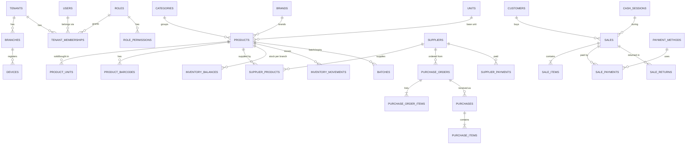
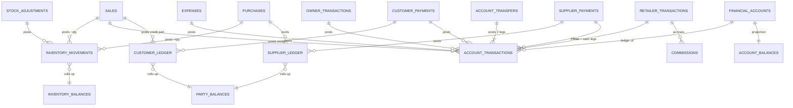
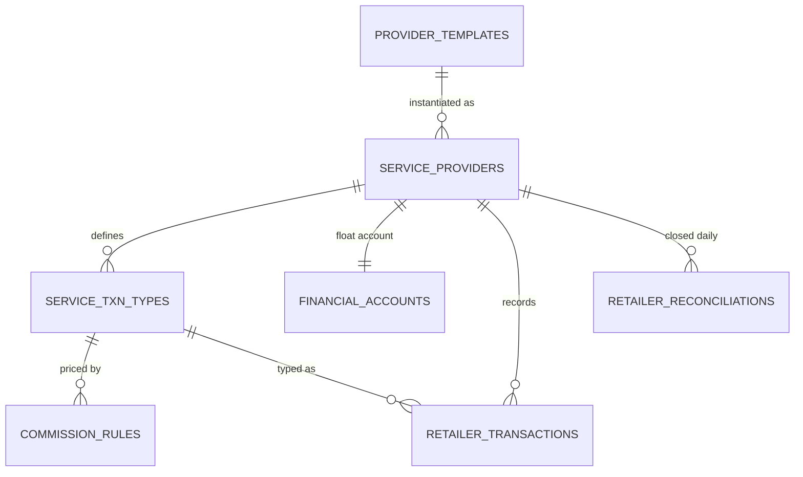
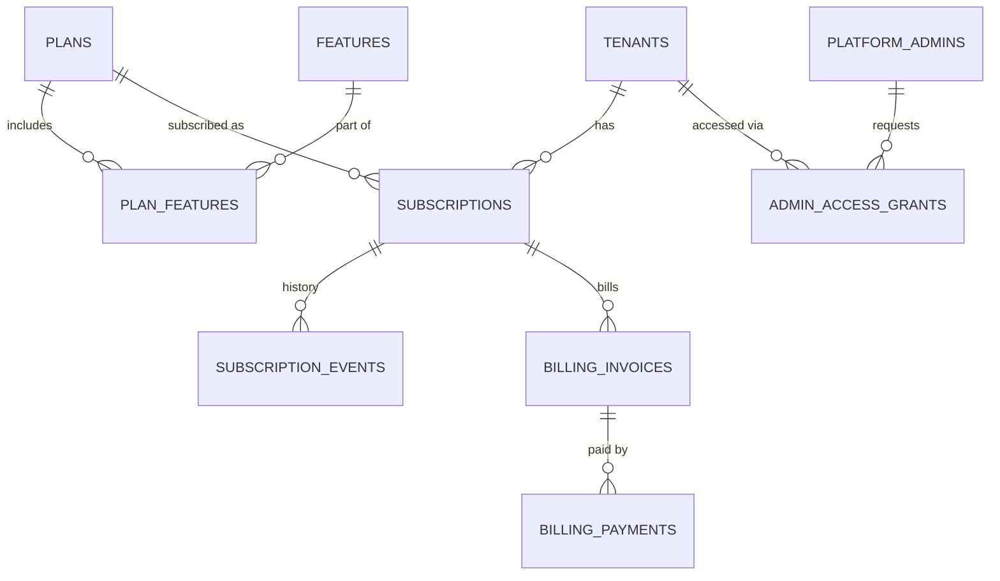

# 03 — Database Schema (MySQL 8.4 LTS, InnoDB, utf8mb4)

## Conventions

| Convention | Rule |
|---|---|
| Engine / charset | InnoDB, `utf8mb4` / `utf8mb4_0900_ai_ci` (full Urdu support) |
| Primary keys | `id` = UUIDv7 stored as **`BINARY(16)`** (client-generated for synced tables; UUIDv7 is time-ordered, so no byte swapping is needed and InnoDB inserts stay sequential). Written as `uuid` below. |
| Money | `bigint` in **paisa** (Rs 1 = 100). The type alias in Drizzle is `money()` |
| Quantity | `decimal(14,3)` in the product's **base unit** (`qty_base`) + the entered unit/qty for display; POS sale quantities may be fractional only for Karyana or Grocery categories |
| Rates/factors | `decimal(12,6)` |
| Time | `datetime(3)` always stored in **UTC** (the connection runs `time_zone = '+00:00'`); business date = `CONVERT_TZ(occurred_at, '+00:00', '+05:00')` (Asia/Karachi has no DST) |
| Enums | `varchar` + `CHECK` constraints (enforced since MySQL 8.0.16), easier to migrate than `ENUM` |
| Booleans / JSON | `tinyint(1)` · `json` |
| Names | snake_case, plural tables |
| Tenant FK | Composite `(tenant_id, x_id) → x(tenant_id, id)`; every tenant table has `UNIQUE (tenant_id, id)` |
| Indexes | Every tenant index **starts with `tenant_id`** |
| "Unique while active" | MySQL has no partial indexes. Use a generated column `active_key tinyint AS (IF(deleted_at IS NULL, 1, NULL)) STORED` and `UNIQUE (tenant_id, sku, active_key)`. Multiple NULLs are allowed, so deleted rows don't collide. Written below as `UNIQUE (…) WHERE <condition>` for readability. |
| 🔒 | **Tenant-scoped table.** It has `tenant_id` and can only be reached through the tenant-scoped query layer (see 01 §3). MySQL has no row-level security, so isolation is enforced in the application and proven by tests. |
| Migrations | MySQL DDL is not transactional, so each migration is small, re-runnable (`IF NOT EXISTS`), and forward-only in production, with a tested backup before each deploy |

**Base column sets** (repeated in every table where marked):

- **`⟨sync⟩`**: `id uuid PK, tenant_id uuid NOT NULL, created_at, updated_at, created_by uuid, updated_by uuid, origin_device_id uuid, version int NOT NULL DEFAULT 1, deleted_at datetime(3) NULL, server_seq bigint NOT NULL`, index `(tenant_id, server_seq)`
- **`⟨doc⟩`**: `⟨sync⟩` without `deleted_at` (documents are voided/reversed, never deleted), plus `branch_id uuid NOT NULL, occurred_at datetime(3) NOT NULL, received_at datetime(3)` (server receive time)
- **`⟨post⟩`** (ledger/posting rows, append-only, deterministic id): `id uuid PK, tenant_id, branch_id, occurred_at, source_type text, source_id uuid, source_line_id uuid NULL, created_at, server_seq`, index `(tenant_id, source_type, source_id)`

---

## A. Platform (global, not tenant-scoped; accessed only by the admin API and the auth service)

```sql
platform_settings (key text PK, value json, updated_at, updated_by)        -- platform name, branding, grace days, etc.

platform_admins (id, name, email UNIQUE, password_hash, totp_secret_enc, role CHECK (super|support|billing),
                 status, last_login_at, created_at)

features (key text PK, module text, name, description)                      -- 'pos','udhaar','supplier_planner','ai_assistant',…

plans (id, code UNIQUE, name, description, currency DEFAULT 'PKR',
       price_monthly bigint, price_yearly bigint, trial_days int,
       limits json,          -- {"users":2,"branches":1,"devices":2,"products":5000,"storage_mb":500}
       is_public bool, sort int, status, created_at, updated_at)

plan_features (plan_id → plans, feature_key → features, PRIMARY KEY (plan_id, feature_key))

tenants (id, slug UNIQUE, name, legal_name, business_type, country DEFAULT 'PK', currency DEFAULT 'PKR',
         timezone DEFAULT 'Asia/Karachi', default_locale DEFAULT 'en',
         status CHECK (active|suspended|archived), suspended_reason, created_at, archived_at)

tenant_sync_counters (tenant_id PK → tenants, last_seq bigint NOT NULL DEFAULT 0)   -- gap-free change sequence

subscriptions (id, tenant_id → tenants, plan_id → plans,
               status CHECK (trialing|active|past_due|expired|suspended|cancelled),
               billing_cycle CHECK (monthly|yearly|custom), trial_ends_at, current_period_start, current_period_end,
               grace_ends_at, cancel_at_period_end bool, price_override bigint NULL,
               overrides json,         -- per-tenant limit/feature exceptions
               is_current bool, created_at, updated_at)
  UNIQUE (tenant_id, current_key)   -- current_key AS (IF(is_current, 1, NULL)): one current subscription per tenant

subscription_events (id, subscription_id, tenant_id, event CHECK (created|trial_started|activated|renewed|plan_changed|
                     extended|past_due|expired|suspended|reactivated|cancelled), from_status, to_status, data json,
                     actor_admin_id NULL, created_at)

billing_invoices (id, tenant_id, subscription_id, number UNIQUE, period_start, period_end, amount bigint, currency,
                  status CHECK (draft|open|paid|void|uncollectible), due_at, paid_at, created_at)
billing_payments (id, invoice_id, tenant_id, amount, method CHECK (bank_transfer|easypaisa|jazzcash|card|manual),
                  gateway, gateway_ref, status, received_at, recorded_by_admin_id, proof_attachment_key)

admin_access_grants (id, admin_id, tenant_id, reason text NOT NULL, scope CHECK (read|write), granted_at, expires_at,
                     revoked_at)                                            -- break-glass

platform_audit_logs (id bigint auto_increment, admin_id, tenant_id NULL, action, target_type, target_id, before json, after json,
                     ip varbinary(16), user_agent, created_at)                      -- append-only, partitioned monthly
```

## B. Identity and access

```sql
users (id, name, phone UNIQUE NULL, email UNIQUE NULL, password_hash, status CHECK (active|disabled),
       preferred_locale, last_login_at, created_at, updated_at)             -- global login identity
  CHECK (phone IS NOT NULL OR email IS NOT NULL)

🔒 tenant_memberships (⟨sync⟩, user_id → users, role_id → roles, display_name, pin_hash NULL,
       status CHECK (invited|active|disabled), all_branches bool DEFAULT true, joined_at)
  UNIQUE (tenant_id, user_id)
🔒 membership_branches (tenant_id, membership_id, branch_id, PRIMARY KEY (membership_id, branch_id))

permissions (key text PK, module, description, is_sensitive bool)          -- global catalog, e.g. 'sales.void'

🔒 roles (⟨sync⟩, name, description, is_system bool, system_key NULL)    -- owner/manager/cashier/inventory/accountant templates
   -- system template rows are copied into each tenant at creation (tenant can then customize non-owner roles)
🔒 role_permissions (tenant_id, role_id, permission_key → permissions, PRIMARY KEY (role_id, permission_key))

🔒 devices (id, tenant_id, branch_id, code char(2..3),                    -- short code used in invoice numbers
       name, platform, user_agent, registered_by, registered_at, last_seen_at, last_push_at, last_pulled_seq bigint,
       status CHECK (active|revoked), revoked_at, revoked_by)
  UNIQUE (tenant_id, code)

refresh_tokens (id, user_id, tenant_id, device_id, family_id, token_hash UNIQUE, issued_at, expires_at,
                rotated_at, revoked_at, revoke_reason, ip, user_agent)
login_attempts (id bigint auto_increment, identifier, ip, success bool, created_at)    -- rate limiting / lockout forensics
```

## C. Organisation and settings

```sql
🔒 branches (⟨sync⟩, code, name, address, phone, is_default bool, status)   UNIQUE (tenant_id, code)

🔒 tenant_profiles (tenant_id PK, shop_name, shop_name_ur, logo_key, primary_color, phone, whatsapp, email, address,
       address_ur, ntn, strn, receipt_header, receipt_footer, receipt_width_mm CHECK (58|80), updated_at, version, server_seq)

🔒 settings (tenant_id, branch_id NULL, key, value json, updated_at, updated_by, version, server_seq,
       scope_branch_id AS (IFNULL(branch_id, 0x00…)) STORED,
       PRIMARY KEY (tenant_id, scope_branch_id, key))   -- all-zero UUID = tenant-wide setting
   -- e.g. 'pos.allow_negative_stock', 'cash.discrepancy_threshold', 'reorder.default_cover_days',
   --      'reinvest.min_cash_reserve', 'sync.offline_session_hours', 'number_format'

🔒 number_series (tenant_id, branch_id, device_id, doc_type, prefix, next_value bigint, PRIMARY KEY (…))
   -- device-local counters mirrored for audit; the device is the authority for its own series

🔒 attachments (id, tenant_id, entity_type, entity_id, storage_key, mime, size_bytes, original_name, uploaded_by, created_at)
```

## D. Catalog

```sql
units (id, tenant_id NULL,                     -- NULL = system unit
       code, name, name_ur, kind CHECK (count|weight|volume|length),
       base_code NULL, factor_to_base decimal(12,6) NULL)   -- g→kg 0.001, ml→l 0.001, dozen→piece 12
unit_conversions (id, tenant_id NULL, from_unit_id, to_unit_id, factor decimal(12,6))   -- generic (not product-specific)

🔒 categories (⟨sync⟩, parent_id NULL → categories, name, name_ur, sort, color, icon)     -- 2 levels = category/subcategory
🔒 brands (⟨sync⟩, name, name_ur, manufacturer)

🔒 tax_rates (⟨sync⟩, name, rate decimal(6,3), is_inclusive bool)                           -- future FBR support

🔒 products (⟨sync⟩,
     sku, name, name_ur, description,
     category_id NULL, brand_id NULL, default_supplier_id NULL,
     base_unit_id → units,                      -- smallest unit stock is counted in (piece, gram, ml)
     is_weighed bool,                           -- sold by weight/volume with decimal qty
     sale_price bigint,                         -- per base unit (overridable per product_unit)
     wholesale_price bigint NULL, min_sale_price bigint NULL,
     tax_rate_id NULL,
     track_stock bool DEFAULT true, track_batches bool DEFAULT false, track_expiry bool DEFAULT false,
     -- reorder parameters (NULL = use supplier / tenant defaults)
     min_stock decimal(14,3) NULL, safety_stock decimal(14,3) NULL, lead_time_days int NULL,
     review_period_days int NULL, max_stock decimal(14,3) NULL,
     is_favorite bool, pos_sort int, image_key NULL, notes,
     status CHECK (active|inactive),
     field_versions json)                      -- per-field version map for sync merges
  UNIQUE (tenant_id, sku) WHERE deleted_at IS NULL
  INDEX (tenant_id, category_id);  FULLTEXT (name, name_ur, sku) WITH PARSER ngram   -- back-office search
  -- POS search runs on the device (in-memory index), not in MySQL

🔒 product_units (⟨sync⟩, product_id, unit_id,
     factor_to_base decimal(14,6) NOT NULL,     -- carton = 24 (packets), packet = 1
     sale_price bigint NULL,                    -- e.g. carton price differs from 24 × packet price
     wholesale_price bigint NULL,
     is_default_sale bool, is_default_purchase bool)
  UNIQUE (tenant_id, product_id, unit_id)

🔒 product_barcodes (⟨sync⟩, product_id, product_unit_id NULL, barcode)
  UNIQUE (tenant_id, barcode) WHERE deleted_at IS NULL

🔒 price_history (⟨post⟩-like: id, tenant_id, product_id, product_unit_id NULL, field CHECK (sale|wholesale|min_sale|cost),
     old_value bigint, new_value bigint, changed_by, changed_at, source_type, source_id)
```

Spec §10 fields that are **derived, not stored on `products`**: current stock (`inventory_balances`), purchase/last/average price (`inventory_balances.avg_cost`, `supplier_products.last_cost`), average daily sales (`product_stats_daily`), reorder point and recommended qty (computed).

## E. Parties

```sql
🔒 suppliers (⟨sync⟩, name, name_ur, contact_person, phone, whatsapp, email, address,
     payment_terms_days int, credit_limit bigint NULL, lead_time_days int DEFAULT 2,
     min_order_amount bigint NULL, order_days json NULL,   -- e.g. {1,4} = Mon, Thu visits
     opening_balance bigint DEFAULT 0, notes, status, field_versions json)

🔒 supplier_products (⟨sync⟩, supplier_id, product_id, supplier_sku, purchase_unit_id → product_units,
     case_size decimal(14,3),                  -- base units per case
     min_order_qty decimal(14,3), order_multiple decimal(14,3),
     last_cost bigint, avg_cost bigint, last_purchased_at, lead_time_days int NULL, is_preferred bool)
  UNIQUE (tenant_id, supplier_id, product_id)

🔒 customers (⟨sync⟩, name, name_ur, phone, whatsapp, address, customer_type CHECK (retail|wholesale|staff),
     credit_limit bigint NULL, credit_days int NULL, opening_balance bigint DEFAULT 0, notes, status, field_versions json)
  INDEX (tenant_id, phone), trigram on name

🔒 customer_ledger (⟨post⟩, customer_id,
     entry_type CHECK (opening|sale|payment|return|adjustment|write_off),
     debit bigint DEFAULT 0, credit bigint DEFAULT 0,   -- debit = customer owes more
     due_date date NULL, memo)
  INDEX (tenant_id, customer_id, occurred_at)

🔒 supplier_ledger (⟨post⟩, supplier_id,
     entry_type CHECK (opening|purchase|payment|return|adjustment),
     debit bigint DEFAULT 0, credit bigint DEFAULT 0,   -- credit = we owe more
     due_date date NULL, memo)

🔒 party_balances (tenant_id, party_type CHECK (customer|supplier), party_id, balance bigint,
     oldest_open_due_date date, last_txn_at, server_seq, PRIMARY KEY (tenant_id, party_type, party_id))  -- projection
```

## F. Financial accounts (cash, bank, wallets)

The spec's `cash_accounts` and `financial_accounts` are **one table**: a cash drawer is just an account of type `cash`.

```sql
🔒 financial_accounts (⟨sync⟩, branch_id NULL, name, name_ur,
     type CHECK (cash_drawer|cash_safe|bank|wallet|card_clearing|other),
     provider_id NULL → service_providers,     -- set for Easypaisa/JazzCash float accounts
     is_service_float bool DEFAULT false,      -- float money is NOT shop money (separate in dashboard)
     -- A wallet can be BOTH a retailer float and a merchant wallet (customers paying for goods by Easypaisa).
     -- account_transactions.txn_type keeps the two apart: sale_receipt = shop money, service_* = retailer money.
     account_number_masked, opening_balance bigint, status)

🔒 payment_methods (⟨sync⟩, name, name_ur, kind CHECK (cash|bank|wallet|card|credit|other),
     financial_account_id NULL,                -- NULL only for kind=credit (goes to customer ledger)
     requires_reference bool, sort, status)

🔒 account_transactions (⟨post⟩, financial_account_id,
     txn_type CHECK (opening|sale_receipt|sale_refund|customer_payment|supplier_payment|purchase_payment|
                     expense|owner_drawing|owner_injection|transfer_in|transfer_out|
                     service_cash_in|service_cash_out|service_fee|commission_received|adjustment|closing_difference),
     amount bigint NOT NULL,                   -- signed: + money in, − money out
     reference, memo, cash_session_id NULL)
  INDEX (tenant_id, financial_account_id, occurred_at)

🔒 account_balances (tenant_id, financial_account_id PK, balance bigint, last_txn_at, server_seq)       -- projection

🔒 account_transfers (⟨doc⟩, from_account_id, to_account_id, amount bigint CHECK (>0), reference, memo,
     status CHECK (completed|voided))

🔒 owner_transactions (⟨doc⟩, financial_account_id, kind CHECK (drawing|injection), amount, memo, status)
```

## G. Inventory

```sql
🔒 inventory_balances (tenant_id, branch_id, product_id,
     qty_on_hand decimal(14,3), qty_reserved decimal(14,3) DEFAULT 0,
     avg_cost decimal(18,4),                   -- WAC per base unit in paisa; fractional to avoid drift (e.g. 1 g of a Rs 250/kg item)
     stock_value bigint, last_movement_at, last_sale_at, last_receipt_at, server_seq,
     PRIMARY KEY (tenant_id, branch_id, product_id))                       -- projection, rebuilt from movements

🔒 inventory_movements (⟨post⟩, product_id, batch_id NULL,
     movement_type CHECK (opening|purchase|sale|sale_return|purchase_return|adjustment_in|adjustment_out|
                          damage|expiry|transfer_in|transfer_out|count_correction),
     qty_base decimal(14,3) NOT NULL,          -- signed
     unit_cost bigint NOT NULL,                -- WAC at posting (for outflows) / landed cost (for inflows)
     total_cost bigint NOT NULL,
     balance_after decimal(14,3) NULL,         -- server-filled for audit
     reason_code, memo, created_by)
  INDEX (tenant_id, branch_id, product_id, occurred_at)
  -- partition by range(occurred_at) yearly once volume warrants

🔒 batches (⟨sync⟩, branch_id, product_id, batch_no, expiry_date date NULL, supplier_id NULL, purchase_id NULL,
     received_qty decimal(14,3), qty_remaining decimal(14,3), unit_cost bigint, received_at)
  INDEX (tenant_id, branch_id, product_id, expiry_date)

🔒 stock_adjustments (⟨doc⟩, reason CHECK (damage|expiry|theft|correction|opening|other), memo,
     status CHECK (completed|voided), approved_by NULL)
🔒 stock_adjustment_items (id, tenant_id, adjustment_id, product_id, batch_id NULL, product_unit_id,
     qty decimal(14,3), qty_base decimal(14,3) /* signed */, unit_cost bigint, memo)

🔒 stock_counts (⟨doc⟩, scope CHECK (full|category|selected), status CHECK (in_progress|completed|cancelled), completed_at)
🔒 stock_count_items (id, tenant_id, count_id, product_id, expected_qty, counted_qty, difference, unit_cost)

🔒 stock_transfers (⟨doc⟩, from_branch_id, to_branch_id, status CHECK (sent|received|cancelled), sent_at, received_at)
🔒 stock_transfer_items (id, tenant_id, transfer_id, product_id, product_unit_id, qty, qty_base, unit_cost)

🔒 product_stats_daily (tenant_id, branch_id, product_id, date,
     qty_sold decimal(14,3), qty_returned decimal(14,3), revenue bigint, cogs bigint, discount bigint,
     txn_count int, stockout bool,             -- stockout days are excluded from demand averages
     PRIMARY KEY (tenant_id, branch_id, product_id, date))                  -- maintained by worker
```

## H. Sales and POS

```sql
🔒 cash_sessions (⟨doc⟩, financial_account_id /* the drawer */, device_id, opened_by, opened_at,
     opening_float bigint, closed_by NULL, closed_at NULL,
     expected_cash bigint NULL, counted_cash bigint NULL, difference bigint NULL,
     denominations json NULL, explanation text NULL, reviewed_by NULL,
     status CHECK (open|closed|reviewed))

🔒 sales (⟨doc⟩, device_id, cash_session_id NULL, invoice_no,
     customer_id NULL, cashier_id, price_tier CHECK (retail|wholesale),
     status CHECK (completed|voided),          -- drafts/held carts live only on device (Dexie.drafts)
     subtotal bigint, line_discount_total bigint, order_discount bigint, tax_total bigint, rounding bigint,
     total bigint, paid_total bigint, change_due bigint, credit_amount bigint,  -- credit_amount → customer_ledger
     cogs_total bigint,                        -- server-authoritative after posting
     notes, void_reason NULL, voided_by NULL, voided_at NULL)
  UNIQUE (tenant_id, invoice_no)
  INDEX (tenant_id, branch_id, occurred_at), (tenant_id, customer_id, occurred_at)

🔒 sale_items (id, tenant_id, sale_id, line_no, product_id, product_unit_id,
     product_name_snapshot, qty decimal(14,3), qty_base decimal(14,3),
     unit_price bigint, discount bigint, tax bigint, line_total bigint,
     unit_cost bigint, cogs bigint)            -- cost filled by posting engine
  UNIQUE (tenant_id, sale_id, line_no)

🔒 sale_payments (id, tenant_id, sale_id, payment_method_id, financial_account_id NULL, amount bigint, reference)

🔒 sale_returns (⟨doc⟩, device_id, return_no, original_sale_id NULL /* NULL = return without receipt */,
     customer_id NULL, cashier_id, reason, refund_method CHECK (cash|account|customer_credit),
     refund_account_id NULL, total bigint, cogs_reversed bigint, status CHECK (completed|voided))
🔒 sale_return_items (id, tenant_id, return_id, original_sale_item_id NULL, product_id, product_unit_id,
     qty, qty_base, unit_price, line_total, restock bool, unit_cost)
```

Voiding a sale (permission `sales.void`, reason required) creates reversing postings. The sale row gets `status = voided` via a separate `sale_voids` mutation, which is the one allowed state change.

## I. Purchasing

```sql
🔒 purchase_orders (⟨doc⟩, po_no, supplier_id, status CHECK (draft|ordered|partially_received|received|cancelled),
     source CHECK (manual|reorder_planner), expected_date, estimated_total bigint, notes,
     ordered_at, ordered_via CHECK (whatsapp|phone|visit|other) NULL, cancelled_reason)
   -- POs are mutable while draft (version-checked), frozen once ordered (status changes only)
🔒 purchase_order_items (id, tenant_id, po_id, product_id, product_unit_id, qty_ordered, qty_received,
     est_unit_cost, recommended_qty NULL /* what the planner suggested, for learning */)

🔒 purchases (⟨doc⟩, purchase_no, supplier_id, po_id NULL, supplier_invoice_no, supplier_invoice_date,
     subtotal, discount, tax, freight, other_charges, total bigint,
     paid_amount bigint, payment_account_id NULL, due_date date NULL,
     status CHECK (completed|voided), notes)
🔒 purchase_items (id, tenant_id, purchase_id, line_no, po_item_id NULL, product_id, product_unit_id,
     qty, qty_base, unit_cost bigint /* per entered unit */, landed_unit_cost_base bigint /* incl. allocated freight */,
     discount, line_total, batch_no NULL, expiry_date NULL, batch_id NULL)

🔒 purchase_returns (⟨doc⟩, return_no, supplier_id, purchase_id NULL, total, settlement CHECK (refund|credit_note),
     refund_account_id NULL, reason, status)
🔒 purchase_return_items (id, tenant_id, return_id, product_id, product_unit_id, batch_id NULL, qty, qty_base, unit_cost, line_total)

🔒 supplier_payments (⟨doc⟩, supplier_id, financial_account_id, amount, reference, memo, status)
🔒 supplier_payment_allocations (id, tenant_id, payment_id, purchase_id, amount)          -- for due-date aging

🔒 customer_payments (⟨doc⟩, customer_id, financial_account_id, amount, reference, memo, receipt_no, status)
🔒 customer_payment_allocations (id, tenant_id, payment_id, sale_id, amount)
```

## J. Expenses

```sql
🔒 expense_categories (⟨sync⟩, name, name_ur, is_system bool, system_key NULL, parent_id NULL,
     is_operating bool DEFAULT true)           -- rent, electricity, gas, internet, salary, transport, repairs,
                                               -- packaging, maintenance, food, misc, other  (owner drawing is NOT here)
🔒 expenses (⟨doc⟩, category_id, financial_account_id, amount bigint CHECK (>0), expense_date date,
     description, payee, attachment_id NULL, is_recurring_instance bool, recurring_id NULL,
     status CHECK (completed|voided), void_reason)
🔒 recurring_expenses (⟨sync⟩, category_id, amount, frequency CHECK (monthly|weekly), day_of_period, next_due_date,
     financial_account_id, description, active)   -- feeds "upcoming obligations"
```

## K. Retailer / financial services (Easypaisa, JazzCash, load, bills)

```sql
provider_templates (code PK, name, kind CHECK (mobile_wallet|mobile_load|bill_payment|other), default_txn_types json)
  -- global seed: easypaisa, jazzcash, jazz_load, telenor_load, zong_load, ufone_load, lesco, sngpl, ptcl, …

🔒 service_providers (⟨sync⟩, template_code NULL, name, kind,
     float_account_id → financial_accounts,    -- e-money / prepaid balance held with the provider
     cash_account_id → financial_accounts,     -- which drawer the service cash goes through (can be shop drawer or separate)
     commission_settlement CHECK (per_txn|periodic) DEFAULT 'per_txn',   -- Al Noor Mart: per_txn
     commission_account_id → financial_accounts,   -- where per-txn commission lands (usually the float itself)
     merchant_account_id NULL → financial_accounts,-- wallet that receives customer payments for goods (see note)
     status)

🔒 service_txn_types (⟨sync⟩, provider_id, code, name, name_ur,
     float_effect smallint CHECK (-1|0|1),     -- cash_in: −1 (we send e-money), cash_out: +1
     cash_effect smallint CHECK (-1|0|1),      -- cash_in: +1, cash_out: −1
     requires_mobile bool, requires_reference bool, status)

🔒 commission_rules (⟨sync⟩, provider_id, txn_type_id, min_amount bigint, max_amount bigint NULL,
     customer_fee_type CHECK (none|fixed|percent), customer_fee_value decimal(12,4),
     commission_type CHECK (none|fixed|percent), commission_value decimal(12,4),
     fee_collected_in CHECK (cash|float|none),
     effective_from date, effective_to date NULL)

🔒 retailer_transactions (⟨doc⟩, device_id, provider_id, txn_type_id, customer_id NULL,
     customer_mobile_enc varbinary NULL, customer_mobile_last4 char(4) NULL,
     amount bigint CHECK (>0), customer_fee bigint, commission bigint,     -- snapshot from rule at time of txn
     commission_rule_id NULL, reference_no, staff_id,
     status CHECK (completed|pending|failed|reversed), notes)
  UNIQUE (tenant_id, provider_id, reference_no)   -- NULL reference_no values don't collide in MySQL

🔒 commissions (⟨post⟩, provider_id, kind CHECK (accrued|received|adjustment), amount bigint, period date /* month */, memo)
   -- per_txn (Al Noor Mart): each txn posts 'accrued' + 'received' together and a +commission leg
   --   on commission_account_id, so the float balance already includes it when reconciling
   -- periodic: 'accrued' per txn, 'received' when the provider pays the month's commission

🔒 retailer_reconciliations (⟨doc⟩, provider_id, business_date,
     opening_float, float_in, float_out, expected_float, actual_float, float_difference,
     opening_cash, cash_in, cash_out, expected_cash, actual_cash, cash_difference,
     txn_count int, volume bigint, commission_accrued bigint, explanation, closed_by,
     status CHECK (closed|reviewed))
  UNIQUE (tenant_id, provider_id, business_date)
```

## L. Insights, notifications and integrations

```sql
🔒 alerts (id, tenant_id, branch_id NULL, type /* low_stock, reorder_now, expiring, customer_overdue, supplier_due,
     cash_discrepancy, service_discrepancy, stock_negative, credit_limit_exceeded, price_below_minimum, subscription_expiring … */,
     severity CHECK (critical|warning|info|positive), entity_type, entity_id, fingerprint /* dedupe key */,
     params json /* i18n message params */, status CHECK (open|acknowledged|snoozed|resolved),
     snoozed_until, first_seen_at, last_seen_at, resolved_at, server_seq)
  UNIQUE (tenant_id, fingerprint, open_key)   -- open_key AS (IF(status <> 'resolved', 1, NULL))

🔒 notifications (id, tenant_id, user_id, alert_id NULL, channel CHECK (in_app|push|email|whatsapp),
     template_key, params json, status CHECK (queued|sent|failed|read), sent_at, read_at, error)
🔒 notification_preferences (tenant_id, user_id, event_key, channels json, quiet_hours json, PRIMARY KEY (…))
🔒 push_subscriptions (id, tenant_id, user_id, device_id, endpoint, keys_enc, created_at)

🔒 integrations (id, tenant_id, kind CHECK (whatsapp|email|sms|payment), provider, config_enc varbinary, status, verified_at)
🔒 message_outbox (id, tenant_id, integration_id, channel, to_enc, template_key, payload json,
     status CHECK (queued|sending|sent|failed), attempts, next_attempt_at, provider_message_id, error, created_at)
     -- until a provider is configured: "Share via WhatsApp" opens wa.me with prefilled text (no API needed)

🔒 report_snapshots (tenant_id, branch_id NULL, kind CHECK (daily|weekly|monthly), period_start, data json, created_at)

🔒 ai_conversations (id, tenant_id, user_id, title, created_at)
🔒 ai_messages (id, tenant_id, conversation_id, role, content, tool_calls json, tokens_in, tokens_out, created_at)
```

## M. Import/export, audit, sync

```sql
🔒 import_jobs (id, tenant_id, kind CHECK (products|opening_stock|customers|suppliers|prices), file_key,
     status CHECK (uploaded|validating|validated|importing|done|failed), total_rows, valid_rows, error_rows,
     options json, created_by, created_at, finished_at)
🔒 import_job_rows (id, tenant_id, job_id, row_no, data json, errors json, status CHECK (valid|error|imported|skipped))
🔒 export_jobs (id, tenant_id, kind, filters json, format CHECK (csv|xlsx|pdf), file_key, status, created_by, created_at)

🔒 audit_logs (id bigint auto_increment, tenant_id, user_id NULL, admin_id NULL /* break-glass */, device_id NULL,
     ip varbinary(16) NULL, user_agent, action /* 'product.price_changed','sale.voided','cash.session_closed' … */,
     entity_type, entity_id, before json, after json, reason, occurred_at, created_at)
  PARTITION BY RANGE COLUMNS (created_at) monthly (partitioned tables can't have FKs; audit rows have none)
  INDEX (tenant_id, created_at), (tenant_id, entity_type, entity_id)
  -- the app's MySQL user has INSERT + SELECT only on this table (no UPDATE/DELETE)

jobs (id bigint auto_increment, tenant_id NULL, queue, name, payload json, status CHECK (queued|running|done|failed),
     attempts int, run_at datetime(3), locked_at, locked_by, last_error, created_at,
     INDEX (status, queue, run_at))            -- worker polls with SELECT … FOR UPDATE SKIP LOCKED (no Redis)

🔒 sync_changes (tenant_id, server_seq bigint, entity_type, entity_id, branch_id NULL, op CHECK (upsert|delete),
     version int, changed_at, PRIMARY KEY (tenant_id, server_seq))        -- change log for pull (retention 90 d)

🔒 sync_mutations (tenant_id, mutation_id uuid, device_id, user_id, entity_type, entity_id, op,
     status CHECK (applied|rejected|conflict), result json, client_created_at, received_at,
     PRIMARY KEY (tenant_id, mutation_id))                                  -- idempotency / inbox log

🔒 sync_conflicts (id, tenant_id, mutation_id, entity_type, entity_id, base_version, server_version,
     client_changes json, server_state json, status CHECK (open|resolved_client|resolved_server), resolved_by, resolved_at)
```

Client-only (Dexie): `sync_queue` (outbox), `sync_state`, `sync_log`, `drafts`, `kv`. See 02-offline-sync.md.

## Table count

About 85 tables: platform 12 · identity 8 · org 6 · catalog 10 · parties 7 · accounts 7 · inventory 12 · sales 7 · purchasing 12 · expenses 3 · retailer 7 · insights/integrations 10 · jobs/audit/sync 8.

---

## ERD

### Core commerce



### Ledgers (every document posts here via source_type/source_id)



### Retailer services



### SaaS platform



---

## Key calculations (defined once, in `packages/domain`)

**Profit (period P, branch B or all):**
```text
Revenue       = Σ sale_items.line_total − order discounts − Σ sale_return_items.line_total     (excl. tax)
COGS          = Σ −inventory_movements.total_cost WHERE type IN (sale, sale_return)
Gross profit  = Revenue − COGS
Shrinkage     = Σ −total_cost WHERE type IN (damage, expiry, adjustment_out, count_correction<0) − gains
Operating exp = Σ expenses.amount WHERE category.is_operating
Service income= Σ commissions (accrued) + customer fees retained
Net profit    = Gross profit − Shrinkage − Operating exp + Service income
(Owner drawings, purchases, supplier payments and transfers are NOT in profit.)
```

**Reorder (per product, per branch):**
```text
ADS (avg daily sales) = weighted: 0.5 × last 7 d + 0.3 × last 30 d + 0.2 × last 90 d  (stockout days excluded)
trend                 = ADS_7 / ADS_30   (clamped 0.5–2.0, shown as ↑/↓)
lead_time L           = product ?? supplier_product ?? supplier ?? tenant default (days)
review period R       = days until next supplier visit (supplier.order_days) ?? tenant default (e.g. 7)
safety_stock SS       = product.safety_stock ?? ceil(ADS × safety_days(default 2))
reorder_point ROP     = ADS × L + SS
days_remaining        = (on_hand − reserved) / ADS
target                = ADS × (L + R) + SS
recommended_base      = max(0, target − (on_hand − reserved) − on_order)
recommended_units     = roundUp(recommended_base / case_size) cases, respecting min_order_qty and order_multiple
status                = on_hand ≤ ADS × L        → 🔴 ORDER NOW
                        on_hand ≤ ROP            → 🟠 Reorder soon
                        else                     → 🟢 OK
```

**Spec §13 example:** Cooking Oil, on hand 20, ADS 7, L 3, SS 10. ROP = 7×3 + 10 = 31; days remaining = 2.9; 20 ≤ 21 (ADS×L) → **🔴 ORDER NOW**. With R = 7: target = 7×10 + 10 = 80, recommended = 60 bottles = **5 cartons of 12**.

**Reinvestment check:**
```text
liquid      = Σ balances of shop accounts (cash + bank + own wallets; service floats excluded)
obligations = supplier dues within 7 d + recurring expenses within 7 d (+ overdue)
available   = liquid − obligations − min_cash_reserve (setting)
ratio       = available / proposed purchase (default: Today's Orders total)
🟢 Safe if ratio ≥ 1.2 · 🟠 Caution if 0.8–1.2 · 🔴 Not yet if < 0.8   — labelled "calculation, not financial advice"
```
